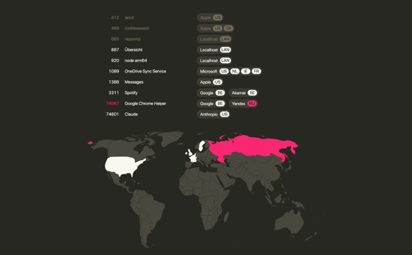
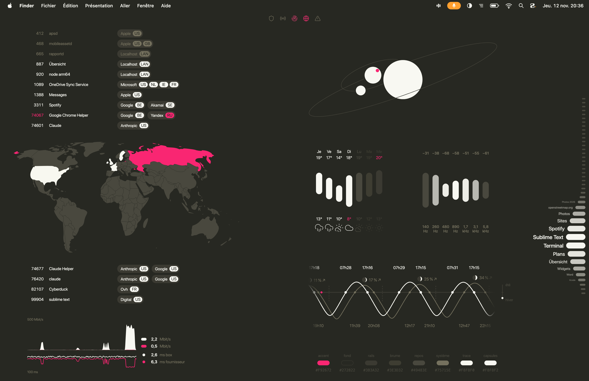

# Capsules – Connexions

Les connexions de ce Mac vers Internet, en direct : une carte du monde et une liste en capsules.
Chaque ligne est un programme, avec ses organisations et ses pays. Les pays où le RGPD ne suit plus vos données passent en rose.

Un widget pour [Übersicht](https://tracesof.net/uebersicht/), gratuit, pour macOS.

Il fait partie de **Capsules**, mon bureau : une composition de widgets et d'applications en capsules, sur fond anthracite.
Tout le bureau, l'animation et les autres widgets : **[fafag.fr › Capsules › Connexions](https://fafag.fr/?capsules/connexions)**

## Installation

1. Installer [Übersicht](https://tracesof.net/uebersicht/).
2. Télécharger `capsules-connexions.widget.zip` et le décompresser.
3. Placer le dossier `capsules-connexions.widget` dans le dossier des widgets (Übersicht → Open Widgets Folder).

Le widget s'affiche en haut à gauche de l'écran. Il tient en un seul fichier JavaScript : aucun script ni aucune commande à installer à côté.

## Comment ça marche

- Toutes les quelques secondes, le widget lance `nettop` (présent sur macOS) pour lister les connexions établies.
- Il demande l'organisation et le pays de chaque adresse à [ip-api.com](https://ip-api.com) (gratuit pour un usage personnel, sans clé), puis les garde en mémoire 30 jours.
- Les connexions terminées restent un moment, estompées selon leur âge.

## Réglages

Tout se règle en haut de `openports.jsx`, dans `MES_REGLAGES`. Les valeurs complètes sont juste en dessous, dans `DEFAUTS` ; une clé absente ou mal écrite garde sa valeur par défaut.

- `pays.focusSauf` : les pays où le RGPD suit vos données (Espace économique européen et pays reconnus « adéquats » par la Commission européenne, novembre 2026). Tous les autres sont « focus », en rose.
- `pays.focus` : des pays à mettre en rose en plus, si vous le souhaitez.
- `pays.toujours` : les pays toujours coloriés sur la carte, même sans connexion.
- `liste.habitues` : les programmes masqués quand la liste est pleine.
- `carte` : position et largeur de la carte (en points depuis le coin haut gauche) ; les deux listes la suivent.

Police : SF Pro Rounded si elle est installée, sinon la police arrondie du système.

## Crédits

- Carte : [Natural Earth](https://www.naturalearthdata.com) 1:110m, domaine public.
- Pays et organisations : [ip-api.com](https://ip-api.com), appelé par chaque Mac pour son propre usage.

---

**In English** – A widget for Übersicht: this Mac's Internet connections, live, on a world map and in a list of capsules (one line per program, with its organisations and countries). Countries outside GDPR protection (outside the EEA and without an EU adequacy decision) glow pink. Uses `nettop` and ip-api.com (free for personal use). Settings are at the top of `openports.jsx` (comments in French). More on [fafag.fr](https://fafag.fr/?capsules/connexions).

Licence MIT – Fafa, [fafag.fr](https://fafag.fr)
